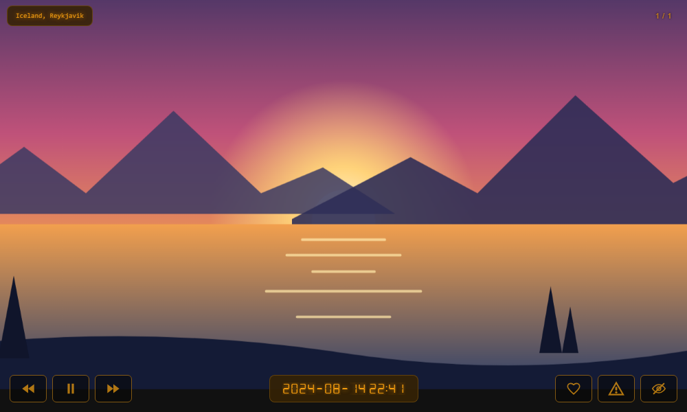
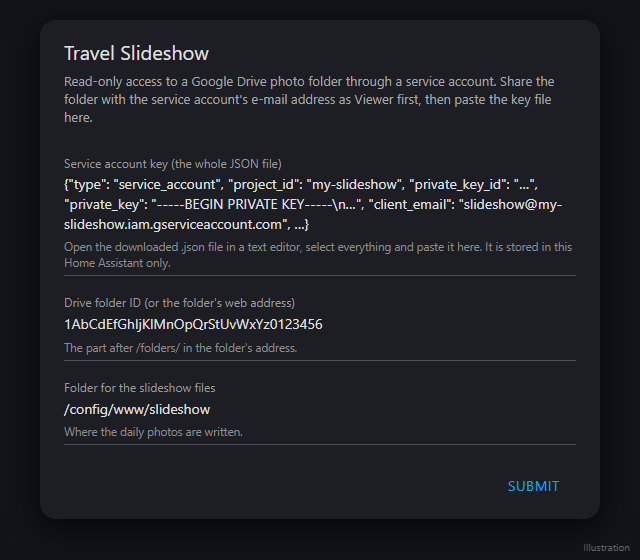
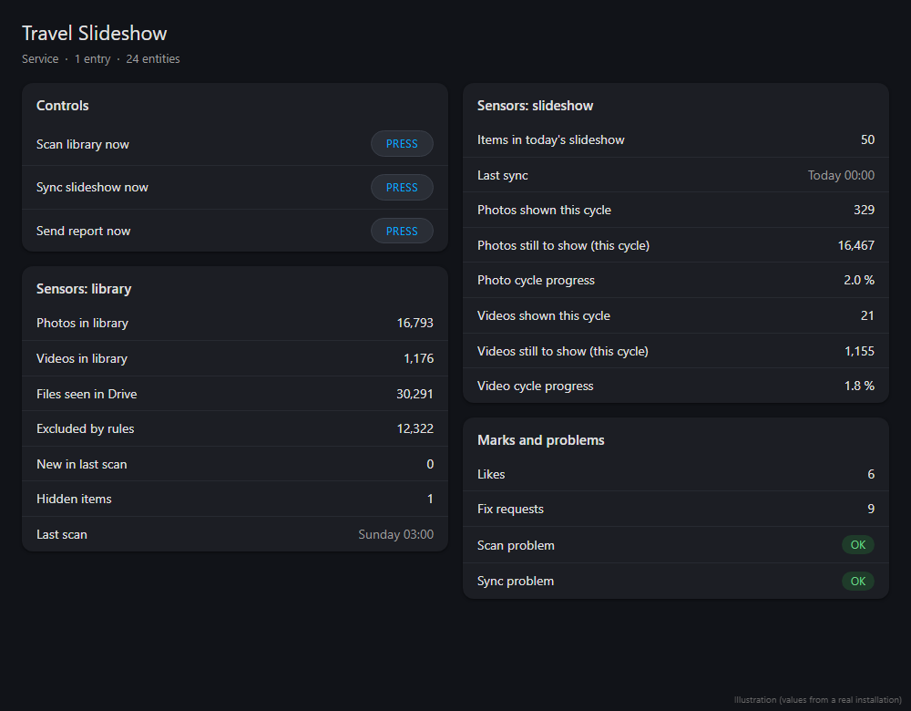
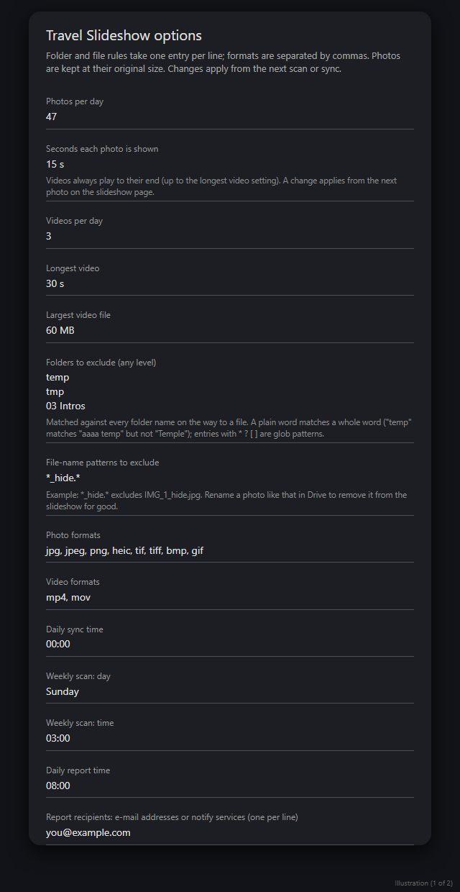
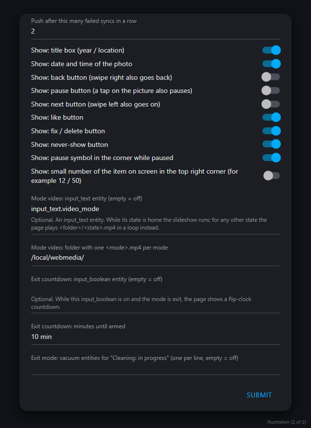

<p align="center">
  
</p>

<h1 align="center">Travel Slideshow</h1>

<p align="center">
  A Home Assistant integration that turns a Google Drive photo and video library into a daily slideshow for your dashboard or a wall tablet.<br>
  Read-only access to Drive, a fresh selection every night, sensors, a daily report, and a ready-made display page.
</p>

<p align="center">
  <br>
  <sub>The slideshow page that ships with the integration (demo picture, all buttons switched on).</sub>
</p>

## What it does

1. **Reads** your Google Drive photo folder (any depth of sub-folders) with a service account that can only *view* what you share with it.
2. **Picks** a new selection every night: by default 47 photos and 3 videos. Every item you have not seen yet has the same chance, so over about a year the whole library is shown before anything repeats.
3. **Prepares** the selection in `/config/www/slideshow`: HEIC, TIFF, BMP and GIF photos become JPG, videos are cut to 30 s and converted to a small MP4, and a `manifest.json` describes the day (title from the folder names, capture date from the photo).
4. **Shows** it on a page served by the integration itself, with gestures and buttons to like a picture, flag it for fixing, or hide it for good.
5. **Reports**: sensors for the library and the cycle, repairs and a push message when something fails, and a daily e-mail with links to the items you marked.

Your originals are never changed, renamed or deleted.

## Contents

- [Install](#install)
- [Google side: service account and folder](#google-side-service-account-and-folder-once)
- [Set up the integration](#set-up-the-integration)
- [Show the slideshow](#show-the-slideshow)
- [How the daily sync works, and automations](#how-the-daily-sync-works-and-automations)
- [Options](#options)
- [Supported formats and what is changed](#supported-formats-and-what-is-changed)
- [Entities and services](#entities-and-services)
- [Marks and the daily report](#marks-and-the-daily-report)
- [Troubleshooting](#troubleshooting)
- [To do](#to-do) · [Version history](#version-history) · [Development](#development)

## Install

**Marketplace / HACS:** add `https://github.com/BRS-Smart-Home/ha-photo-slideshow` as a custom repository (category *Integration*),
download *Travel Slideshow* (choose the newest release) and restart Home Assistant.

**Manual:** copy the folder `custom_components/photo_slideshow` into `/config/custom_components/` and restart Home Assistant.

Requirements: Home Assistant 2026.1 or newer, and `ffmpeg` for video conversion (it is part of Home Assistant OS and the
standard container). The photo library `pillow-heif` is installed automatically.

## Google side: service account and folder (once)

The integration signs in to Google Drive as a **service account**: a robot account with its own e-mail address and key file.
It sees **only the folders you share with it** and, when shared as *Viewer*, it cannot change or delete anything. Your own Google
password is never used. This needs no billing and no Google Workspace; a normal Google account is enough.

### 1. Create a Google Cloud project

1. Open <https://console.cloud.google.com/> and sign in with any Google account. It does **not** have to be the account that owns the photos.
2. Click the project drop-down in the top bar, then **New project**. Name it, for example `ha-photo-slideshow`, and click **Create**.
3. Make sure the new project is the selected one in the top bar.

### 2. Enable the Google Drive API

1. In the menu choose **APIs & Services → Library**.
2. Search for **Google Drive API**, open it and click **Enable**.

### 3. Create the service account

1. Choose **IAM & Admin → Service Accounts** and click **Create service account**.
2. Give it a name such as `photo-slideshow` and click **Create and continue**.
3. Skip the role and the user-access steps (the account needs no Cloud role at all) and click **Done**.
4. Open the new service account in the list and copy its **e-mail address**. It looks like
   `photo-slideshow@ha-photo-slideshow.iam.gserviceaccount.com`. You need it in step 5.

### 4. Download the JSON key

1. In the service account, open the **Keys** tab and choose **Add key → Create new key**.
2. Select **JSON** and click **Create**. A `.json` file is downloaded. Google shows it only this once.
3. Treat the file like a password: do not put it in a public repository, a chat or a screenshot. If it ever leaks,
   delete the key in the same **Keys** tab and create a new one (see [Replacing the key](#replacing-the-key)).

> If **Create new key** is greyed out or refused, an organisation policy (`iam.disableServiceAccountKeyCreation`) blocks key
> creation. Use a personal Google account for the Cloud project, or ask your Workspace administrator to allow it.

### 5. Share the photo folder with the service account

1. Open [Google Drive](https://drive.google.com/) with the account that owns the photos.
2. Right-click the top photo folder, choose **Share**, and paste the service account's e-mail address from step 3.
3. Set the role to **Viewer**, untick *Notify people* (the robot has no mailbox) and click **Share**.

The folder and everything below it is now readable by the integration; nothing else in your Drive is.

### 6. Copy the folder ID

Open the shared folder in Drive. The address looks like

```
https://drive.google.com/drive/folders/1AbCdEfGhIjKlMnOpQrStUvWxYz0123456
```

The part after `/folders/` is the **folder ID**. You can also paste the whole address; the integration extracts the ID.

## Set up the integration

1. In Home Assistant go to **Settings → Devices & services → Add integration → Travel Slideshow**.
2. Paste the **entire content of the `.json` key file** (open it in a text editor, select all, copy), the **folder ID** and, if you
   like, a different **output folder** (default `/config/www/slideshow`).
3. Submit. The key is stored inside Home Assistant only and is sent to Google only to sign in.

<p align="center"><br>
<sub>Setup dialog (illustration).</sub></p>

The first scan of the library starts right away in the background; for tens of thousands of files it takes a few minutes. When it is
done the sensors fill in. The first slideshow is built at the next daily sync (default 00:00), or at once when you press
**Sync slideshow now**.

<p align="center"><br>
<sub>The device page: three buttons and the sensors (illustration with values from a real library).</sub></p>

### Replacing the key

**Settings → Devices & services → Travel Slideshow → ⋮ → Reconfigure**, then paste the content of the new key file. The library and
all marks are kept. Afterwards delete the old key in the Google Cloud Console (**Service Accounts → Keys**).

## Show the slideshow

The integration serves the page itself, so there is nothing to copy. Add a **Webpage** card (or an iframe card) to a dashboard:

```yaml
type: iframe
url: /photo_slideshow/index.html?1
aspect_ratio: 56%
```

or open `http://<your-home-assistant>:8123/photo_slideshow/index.html` full screen, for example on a kiosk tablet.

**Gestures:** tap = pause / play, swipe left = next, swipe right = previous. The optional on-screen keys (see below) do the same.

**Buttons (bottom right):** ♥ like, ⚠ fix or delete, 👁 never show again. See [Marks](#marks-and-the-daily-report).

**Updates and caching:** some kiosk browsers keep a copy of a page for a long time. The number behind the address (`?1`) is a
cache breaker: **raise it after every update of the integration** (`?1` → `?2`) and the page and its style sheet are loaded again.

**Access token:** the like / fix / hide buttons talk to Home Assistant. Inside a dashboard card the page uses your logged-in
session. On a screen without a session (a kiosk) create a long-lived access token in your profile and save it as
`/config/www/ha-token.js` containing exactly:

```js
const ha_token = "PASTE-THE-TOKEN-HERE";
```

Keep that file private. Without it the slideshow itself still runs; only the buttons and the optional modes stop working.

**Your own look:** colours or fonts can go into `/config/www/slideshow_custom.css`, which the page loads if it exists.
`?media=/local/other/` points the page to another output folder.

### What is on the page

| Element | Option (Configure) | Default |
|---|---|---|
| Title box: country and place, from the folder names | Show: title box | on |
| Rolling clock with the date and time the photo was taken | Show: date and time | on |
| ♥ / ⚠ / 👁 mark keys | Show: like, fix, never-show | on |
| ⏮ ⏸ ⏭ navigation keys | Show: back, pause, next | off (gestures instead) |
| Pause symbol in the corner while paused | Show: pause symbol | on |
| Small `12 / 50` counter in the top right corner | Show: counter | off |

### Optional extras (off by default)

For a wall display that also plays videos for house modes. All empty by default; then the page never touches them.

| Option | What it does |
|---|---|
| Mode video entity | An `input_text` such as `input_text.video_mode`. `home` runs the slideshow; any other value (`coffee`, `exit`, `sleep` ...) plays `<folder>/<value>.mp4` in a loop instead. |
| Mode video folder | Where those videos live, default `/local/webmedia/` (`/config/www/webmedia`). |
| Exit countdown entity and minutes | An `input_boolean`: while it is on and the mode is `exit`, a flip clock counts the minutes until the house is armed. |
| Vacuum entities | While the mode is `exit` and any of these is cleaning, a "Cleaning: in progress" note shows. |

## How the daily sync works, and automations

The integration has its own schedule, so **no automation is needed** for normal use:

| Job | Default | What it does |
|---|---|---|
| Weekly scan | Sunday 03:00 | Lists the whole Drive folder again and applies the folder, file and format rules. Finds new photos. |
| Daily sync | every day 00:00 | Picks today's items, downloads and converts them into the output folder and writes `manifest.json`. |
| Daily report | every day 08:00 | E-mails the marks collected since the last report (only when something was marked). |

Times are options. The same jobs can be started by hand with the buttons or the services `photo_slideshow.scan` and
`photo_slideshow.sync`. These examples show how to use them from automations.

**Catch up after downtime**: build the slideshow when Home Assistant starts if the last sync is more than 26 hours old.

```yaml
alias: Slideshow - catch up after a restart
triggers:
  - trigger: homeassistant
    event: start
conditions:
  - condition: template
    value_template: >-
      {{ not has_value('sensor.travel_slideshow_last_sync')
         or (now() - states('sensor.travel_slideshow_last_sync') | as_datetime).total_seconds() > 93600 }}
actions:
  - delay: "00:02:00"            # let the network come up
  - action: photo_slideshow.sync
mode: single
```

**Sync at your own time or only when it suits you**: switch the built-in schedule to a time you never use (option *Daily sync
time*) or simply run the service from your own trigger, for example when everybody has left the house:

```yaml
alias: Slideshow - refresh when nobody is home
triggers:
  - trigger: state
    entity_id: zone.home
    to: "0"
    for: "00:10:00"
conditions:
  - condition: template
    value_template: >-
      {{ (now() - states('sensor.travel_slideshow_last_sync') | as_datetime).total_seconds() > 43200 }}
actions:
  - action: photo_slideshow.sync
```

**Tell me when something fails and try again later**:

```yaml
alias: Slideshow - sync problem
triggers:
  - trigger: state
    entity_id: binary_sensor.travel_slideshow_sync_problem
    to: "on"
actions:
  - action: notify.notify          # your own notify service
    data:
      title: Travel Slideshow
      message: The slideshow could not be built. Retrying in 30 minutes.
  - delay: "00:30:00"
  - action: photo_slideshow.sync
mode: single
```

**Rescan after you uploaded new photos** (the weekly scan would find them on Sunday): press `button.travel_slideshow_scan_library_now`
or call `photo_slideshow.scan`. Both services return their statistics, which you can use in a script with `response_variable`.

## Options

All settings are options of the integration (**Configure**).

<p align="center">
  
  <br>
  <sub>The options dialog (illustration, default values).</sub>
</p>

| Option | Default | Notes |
|---|---|---|
| Photos / videos per day | 47 / 3 | about one year for a 17,000-photo library |
| Seconds each photo is shown | 15 | videos always play to their end |
| Longest video / largest video file | 30 s / 60 MB | longer or bigger videos are cut or skipped |
| Folders to exclude | `temp`, `tmp` | any level; plain words match whole words (`temp` does not match `Temple`); entries with `* ? [ ]` are glob patterns. One per line |
| File-name patterns to exclude | `*_hide.*` | rename `IMG_1.jpg` to `IMG_1_hide.jpg` in Drive and it leaves the slideshow for good |
| Photo formats | jpg, jpeg, png, heic, tif, tiff, bmp, gif | separated by commas; photos keep their original size (safety cap 8192 px) |
| Video formats | mp4, mov | |
| Daily sync / weekly scan / daily report | 00:00 / Sunday 03:00 / 08:00 | |
| Report recipients | empty | an e-mail address (sent through the Google Mail integration) or a notify service. Empty = no report |
| Push after failed syncs | 2 | |
| Show: ... | see above | each element of the page can be switched on or off |
| Mode video, exit countdown, vacuums | empty | see *Optional extras* |

Changes apply from the next scan or sync; the page options are picked up at the next slide.

## Supported formats and what is changed

Only copies are changed. The files in Google Drive are never touched; every day's selection is written as new files to the output
folder (default `/config/www/slideshow`), which is replaced by a freshly built one at each sync.

### Photos

| Format | Supported | What happens |
|---|---|---|
| JPG / JPEG | yes (default) | Copied **unchanged** (EXIF kept) when its long side is at most 8192 px |
| PNG | yes (default) | Copied **unchanged** when its long side is at most 8192 px |
| HEIC (iPhone) | yes (default) | Converted to **JPG**, quality 90, rotated upright from the EXIF orientation. Needs `pillow-heif` (installed automatically) |
| TIFF / TIF | yes (default) | Converted to JPG, quality 90, rotated upright |
| BMP | yes (default) | Converted to JPG, quality 90 |
| GIF | yes (default) | Converted to a still JPG (first frame, no animation) |
| WebP, other formats Pillow can open | untested | Can be added in the *Photo formats* option; they would be converted to JPG |
| RAW (CR2, NEF, ARW, DNG ...), PSD | **no** | Skipped |

Other changes to photos:

- **Size:** photos keep their original resolution (4K stays 4K). Only a picture longer than 8192 px on its long side is scaled
  down to 8192 px (a safety limit for the display, not a setting).
- **Transparency** is lost in photos that have to be converted (a GIF, or a PNG over the size limit): they are saved as plain JPG.
- **File name:** the copy is renamed to `<number>_<year>_<country>_AAA_<place>_AAA_<original name>.<ext>`; the page reads the
  title (country, place) from it and from the manifest, and the capture date and time from the photo's metadata in Drive.
- **Nothing is drawn into the picture:** no watermark, no text, no crop. The page shows the picture scaled to fill the screen
  (`object-fit: cover`, so the edges can be cropped on a screen with another shape) and moves the camera slowly over it
  (see [To do](#to-do)).

### Videos

| Format | Supported | What happens |
|---|---|---|
| MP4 (H.264) | yes (default) | Re-encoded as described below |
| MOV (iPhone, Apple) | yes (default) | Re-encoded as described below |
| AVI, MKV, M4V, WebM ... | untested | Can be added in the *Video formats* option; ffmpeg reads most of them and the result is the same MP4 |

Every video is **always** re-encoded by ffmpeg into a small file that plays on any tablet:

- **Container and codec:** MP4, H.264 (`libx264`, `yuv420p`, fast start), CRF 28.
- **Resolution:** scaled down to at most **720p** (height 720, width follows; never scaled up).
- **Sound:** **removed** (the slideshow is silent).
- **Length:** cut after the **longest video** setting (default 30 s). A source video that Drive reports as longer than the limit is
  not picked at all; when Drive reports no length, the file is judged by its size and cut at the limit.
- **Size:** if the result is still larger than the **largest video file** setting (default 60 MB) it is encoded once more at
  480p and CRF 34. If it is still too big, the video is dropped for that day and replaced by another one. A source file bigger
  than the size limit is not picked at all.

### If a file cannot be converted

A photo or video that fails (corrupt file, missing `pillow-heif` or `ffmpeg`, timeout) is **replaced by another item** of the same
kind and is not counted as shown. The day is built with what worked; if too many items fail, the sync is reported as a problem
(*Sync problem* sensor and a Repair).

## Entities and services

**Sensors:** photos / videos in library, files seen in Drive, excluded by rules (the attribute `by_rule` lists the reasons), new in
last scan, hidden items, last scan, last sync, items in today's slideshow, likes, fix requests, photos / videos shown this cycle,
unique photos / videos shown (ever), photos / videos still to show (this cycle), and photo / video cycle progress.

**Binary sensors:** *Scan problem* and *Sync problem*, switched on when Drive access or a sync fails. A failure also opens a
**Repair** with a plain explanation, and sends a push message after the configured number of failed syncs in a row.

**Buttons:** *Scan library now*, *Sync slideshow now*, *Send report now*.

| Service | Purpose |
|---|---|
| `photo_slideshow.scan` | Rescan the Drive folder; returns the statistics |
| `photo_slideshow.sync` | Build today's slideshow now; returns the result |
| `photo_slideshow.dry_run` | Count what the rules keep or remove (with the current rules or ones you pass in); changes nothing |
| `photo_slideshow.mark` | `like`, `fix` or `hide` an item by its Drive file ID (used by the buttons on the page) |
| `photo_slideshow.send_report` | Send the report now (does not clear the list unless `clear: true`) |

## Marks and the daily report

| Button | Meaning | What happens |
|---|---|---|
| ♥ like | "Nice one" | Counted and listed in the report. Nothing else changes |
| ⚠ fix or delete | "This needs attention" (crop, rotate, delete ...) | The picture leaves the slideshow, is listed in the next report with a link to the file in Drive, and the flag is cleared after that report |
| 👁 never show | "Do not show this again" | Hidden for good, until the file is renamed or deleted in Drive |

The report arrives every morning at the report time, only when something was marked, with Drive links to every item.

## Troubleshooting

| Message or symptom | Cause and fix |
|---|---|
| *This is not valid JSON* / *not a service account key* | Paste the **whole** key file, from the first `{` to the last `}`. |
| *Google refused the key* | The key was deleted or belongs to another service account. Create a new key and use **Reconfigure**. |
| *The folder was not found* | The folder is not shared with the service account's e-mail address, or the ID is wrong. Share it as Viewer and check the ID. |
| *This ID is a file, not a folder* | You copied the ID of a file. Open the folder itself and copy the address from there. |
| Slideshow page is black | The first sync has not run yet. Press **Sync slideshow now**. |
| Videos do not play | Check that `ffmpeg` exists (it does on Home Assistant OS) and look at *Sync problem* and the Home Assistant log. |
| Buttons do nothing | The page has no access token. Embed it in a dashboard card or create `/config/www/ha-token.js` (see above). |
| The page does not change after an update | Raise the number behind `index.html?` in the dashboard URL. |
| Sensors show 0 files | The library scan has not finished, or the folder is empty or the rules exclude everything. Use `photo_slideshow.dry_run`. |

## To do

**Smart camera moves.** Today the page moves the camera over every photo the same simple way (a slow pan of about 8 % at 1.2x
zoom, horizontal for wide pictures and vertical for tall ones, in a random direction, over the "seconds each photo is shown").
It knows nothing about what is in the picture, so it can pan away from the subject. Planned:

- A **focus point for each photo**, found with a lightweight saliency analysis at sync time (no cloud, nothing leaves Home
  Assistant) and written to `manifest.json`.
- The page then **zooms and pans toward the subject** and keeps it in view instead of moving at random.
- Later: **face-aware** moves that never cut off a head.

Other ideas: nearest town from the GPS data of a photo, stills for longer videos, RAW and PSD support, and a native dashboard card
instead of the iframe. Suggestions are welcome as GitHub issues.

## Version history

| Version | What it does |
|---|---|
| 0.1.x | Connects to Google Drive with a **service account** (read-only), scans the photo folder, applies the folder / file / format rules and reports the numbers as sensors. |
| 0.2 | Nightly sync into `www/slideshow`: 47 photos + 3 videos, equal chance for every unused item, photos at original size (HEIC/TIFF/BMP/GIF become JPG), videos cut at 30 s and converted to a small MP4, `manifest.json`, failed items replaced, repair + event on errors, push after 2 failed syncs. |
| 0.3 | Marks (like / fix / never show) with services and a daily e-mail report with Drive links. |
| 0.4 | Options: seconds per photo, show / hide every element of the slideshow page; manifest carries capture time, path and the options; "Send report now". |
| 0.5.0 | Sensors: unique photos / videos shown (ever) and photos / videos still to show in this cycle. |
| 0.6.0 | New option "Show: item counter". |
| 0.7.0 | The slideshow page ships with the integration at `/photo_slideshow/index.html`. Optional extras (mode videos, exit countdown, cleaning note) are options, off by default. |
| **0.7.1** | The page passes its `?number` on to its style sheet, so raising the number in the dashboard URL refreshes both after an update. |

## Development

The full design is in [docs/SPEC.md](docs/SPEC.md). The logic that needs no Home Assistant (rules, titles, picking, state, report,
file names) is plain Python with tests in `tests/test_logic.py` (`pytest`, or call `run_all()`).

The screenshots in `docs/images` are illustrations: the slideshow picture is a drawn demo image rendered by the real page, and the
dialogs are mock-ups built from the integration's own labels and default values.
